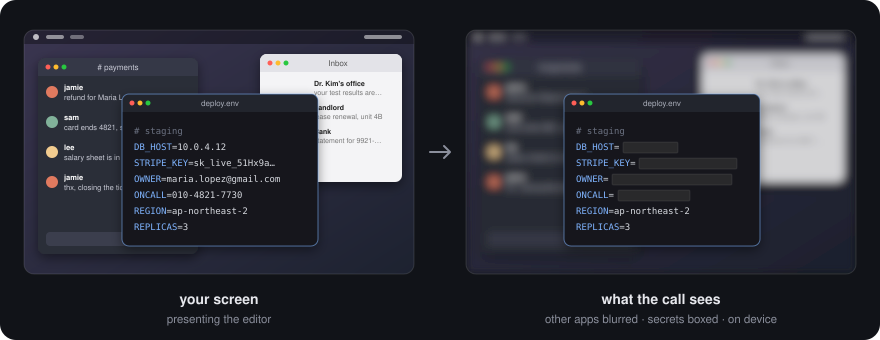
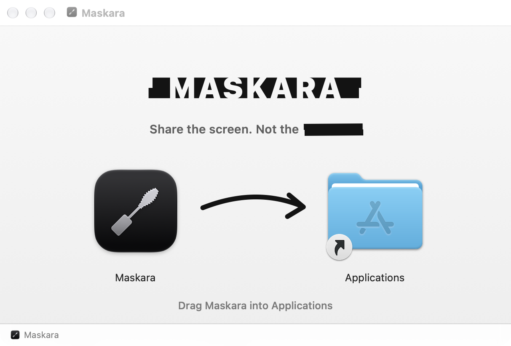

# Maskara

<p align="center">
  
</p>

<p align="center">
  <a href="https://github.com/maskaradev/maskara-releases/releases/latest"><b>download</b></a> · <a href="#install">install</a> · <a href="#updates">updates</a> · <a href="#check-a-download">check a download</a> · <a href="https://github.com/maskaradev/maskara-ai">maskara-ai</a>
</p>

<p align="center">
  <a href="https://github.com/maskaradev/maskara-releases/releases/latest"></a>
  
  
  
</p>

---

**share your screen without leaking it.** everything but the app you present is blurred, and personal data inside that app is boxed out before a frame leaves your Mac.

<p align="center">
  
</p>

- **the app you present, nothing else.** other apps, notifications and the wallpaper are blurred. switching to the call (Discord, Slack, Zoom, Teams) keeps presenting the app you were in.
- **secrets boxed.** api keys, passwords, emails, phone numbers, ids, cards and ip addresses become solid boxes, not pixelation, which can be undone.
- **fail-closed.** whatever changed on screen stays blurred until it has been read: scrolling blurs for a moment instead of leaking for a moment.
- **any call app.** Maskara is a window you share, in Discord, Slack, Zoom, Meet or Teams.
- **on your Mac.** Vision reads the text and [maskara-ai](https://github.com/maskaradev/maskara-ai) finds the personal data, both on device. frames go nowhere but Maskara's own window.

## install

<p align="center">
  
</p>

1. download `Maskara-x.y.z.dmg` from [the latest release](https://github.com/maskaradev/maskara-releases/releases/latest), open it and drag Maskara into Applications.
2. open Maskara and press **Open Settings**. turn Maskara on under Privacy & Security › Screen & System Audio Recording, then press **Reopen**.
3. in your call, share the window **Maskara — share this window**, not the entire screen. in Discord: Share Your Screen › Applications › Maskara.
4. click the app you want to present.

**Help › How to Share Maskara** shows the steps again. macOS 14 or later, on Apple silicon.

## updates

Maskara checks for updates once a day and installs one when you agree; **Maskara › Check for Updates…** checks now. updates come from [`appcast.xml`](appcast.xml) in this repository, through [Sparkle](https://sparkle-project.org). each update is signed with a key that only the release pipeline holds, and Maskara installs it only if the signature matches the key built into the app, so a tampered download is refused.

the update check is the only network request Maskara makes.

## check a download

every build is signed with Developer ID (team `D6MU237526`) and notarized by Apple, with the ticket stapled, so it opens without a warning, even offline. to see that for yourself:

```bash
spctl --assess --type open --context context:primary-signature -v Maskara-0.2.0.dmg
# Maskara-0.2.0.dmg: accepted
# source=Notarized Developer ID

spctl --assess -vv /Applications/Maskara.app
# origin=Developer ID Application: … (D6MU237526)
```

## uninstall

quit Maskara and move it to the Trash. to remove what it leaves behind as well:

```bash
tccutil reset ScreenCapture dev.maskara.app    # the screen recording permission
defaults delete dev.maskara.app                # settings
rm -rf ~/Library/Caches/dev.maskara.app ~/Library/HTTPStorages/dev.maskara.app
```

## this repository

it holds the builds, attached to [releases](https://github.com/maskaradev/maskara-releases/releases), and `appcast.xml`, the update feed. the release pipeline writes both; don't edit the feed by hand. found a problem? [open an issue](https://github.com/maskaradev/maskara-releases/issues).

the personal data detection is open source: [maskara-ai](https://github.com/maskaradev/maskara-ai).
